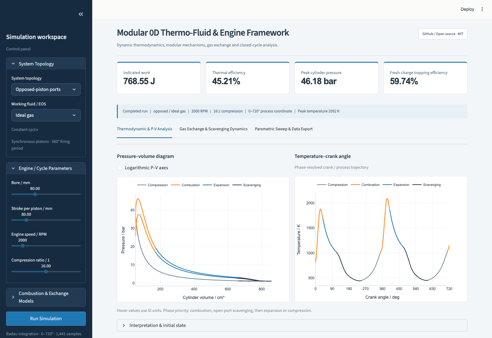

# Modular 0D Framework

[中文](README.zh-CN.md) · [English](README.md) · [日本語](README.ja.md) · [Deutsch](README.de.md)

Dieses Repository enthält ausschließlich dynamische Motor- und Gaswechselmodelle. Stationäre Brayton-/Rankine-Prozesse und Exergieanalysen werden separat in [Thermo Cycles](https://github.com/1844514356zjc-dev/thermo-cycles) gepflegt.

**Komponierbare nulldimensionale Thermodynamik, Mechanismen mit veränderlichem Volumen und Gaswechselmodelle für die Forschung an mechanischen und thermischen Systemen.**

Python 3.10+ · NumPy / SciPy · CoolProp · Streamlit / Plotly · MIT-Lizenz

## Projektübersicht und Kernfunktionen

Das Framework berechnet ein homogenes gasförmiges Kontrollvolumen. Mechanismen, Gasrandbedingungen, Stoffeigenschaften, Wärmequellen und Wandwärmeübergang werden unabhängig eingebunden. Ein gemeinsamer Zeitintegrator unterstützt konventionelle Viertaktmotoren, synchrone Gegenkolbenmotoren, geschlossene Gasfedern und einen analytisch überprüfbaren idealen Otto-Prozess. Das englischsprachige Dashboard stellt diese Kombinationen bereit, ohne die Grundgleichungen zu verändern.

- **Abstraktion der Kinematik:** `BaseMechanism` benötigt lediglich das Volumen und dessen Winkelableitung. Ein- und Gegenkolbenmodelle verwenden analytische Schubkurbelkinematik; eigene Mechanismen implementieren dieselben beiden Methoden.
- **Kombinierbare Gaswechselelemente:** Beliebig viele `PoppetValve`- und `PistonMaskedPort`-Elemente können auch gemeinsam eingesetzt werden. Ventile berücksichtigen Nockenhub sowie Mantel- und Engquerschnittsgrenzen, Steuerfenster die tatsächliche Freigabe durch den Kolben.
- **Austauschbare Stoffmodelle:** Zur Wahl stehen `IdealGas` mit konstanten Stoffwerten und `CoolPropGas`. Dichte, innere Energie, Enthalpie, Wärmekapazitäten und Ableitungen der Zustandsgleichung aus CoolProp gehen unmittelbar in die dynamische Energiebilanz ein, nicht nur in die Nachverarbeitung.
- **Austauschbare Wärmequellen:** Unterstützt werden normierte periodische Wiebe-Wärmefreisetzung, kein Wärmeeintrag und vorzeichenbehaftete isochore Otto-Wärmeimpulse. Eigene Quellen implementieren `heat_release(theta) -> J/rad`.
- **Erhaltungsdiagnostik:** Implizite `Radau`-/`BDF`-Integration, Überwachung der Druckkonsistenz mit der Zustandsgleichung, vorzeichenbehaftete Massenströme und zusammen mit dem Zustand integrierte Wärme-, Arbeits- und Enthalpiesummen.
- **Interaktive Forschungsoberfläche:** Topologiespezifische Eingaben, phasenaufgelöste Diagramme, SI-Hoverwerte, doppelt logarithmische P–V-Achsen, Drehzahl-/Verdichtungsverhältnisstudien und zum Berechnungssnapshot passende CSV-/JSON-Exporte.



### Voreinstellungen und Gültigkeitsbereich

| Voreinstellung | Mechanismus | Gaswechsel | Wärmemodell | Stoffmodell |
| --- | --- | --- | --- | --- |
| Gegenkolben mit Steuerfenstern | Zwei synchrone Schubkurbelkolben | Kolbengesteuerte Ein-/Auslassfenster | Wiebe, Wärmefreisetzung alle 360° | Ideales Gas oder CoolProp-Gas |
| Viertakt mit Hubventilen | Ein Schubkurbelkolben | Nockengesteuerte Ein-/Auslassventile, 720° | Wiebe, Wärmefreisetzung alle 720° | Ideales Gas oder CoolProp-Gas |
| Geschlossener idealer Otto-Prozess | Verdichtung/isochore Pause/Expansion/isochore Pause | Keiner | Vorzeichenbehaftete isochore Wärmeimpulse | Passendes ideales Gas mit konstanten Stoffwerten |
| Geschlossene adiabate Gasfeder | Ein Schubkurbelkolben | Keiner | Keine Wärmequelle, kein Wandwärmeverlust | Ideales Gas oder CoolProp-Gas |

Motorrechnungen beschreiben Anlauftransienten über 0–720°, keine konvergierten periodisch stationären Zyklen. Der Gegenkolbenfall setzt in diesem Intervall zweimal Wärme frei, der Viertaktfall einmal. Beim Otto-Benchmark ist der Winkel eine Prozesskoordinate mit isochoren Haltephasen und keine realisierbare kontinuierliche Kurbelbewegung. Anfangs- und Endzustand schließen konstruktionsbedingt innerhalb der numerischen Toleranz.

Die dynamische CoolProp-Anbindung ist auf homogene einphasige Gase im Temperaturbereich des Backends begrenzt. **Auch bei realgasbasierter Zylinderenergie und Zustandsgleichung bleibt das Düsenmodell eine lokal idealisierte Näherung für kompressible Strömung.** Es verwendet stromaufwärts cp/cv und R_eff=p/(rho*T). Reaktionschemie, Phasenwechsel, Flüssigkeitshydraulik und gekoppelte Mehrvolumennetze sind nicht enthalten. Ein benanntes Arbeitsgas mit Wiebe-Wärmequelle beschreibt einen vorgegebenen nichtreaktiven Wärmeeintrag, kein chemisch aufgelöstes Brennstoff-/Fluidpaar. Das vorhandene Rankine-Modul ist von diesem rein gasförmigen dynamischen Modell getrennt.

## Mathematische und physikalische Modellierung

Kerneingaben verwenden SI-Einheiten und Radiant. Die Oberfläche rechnet mm, mg, bar und Kurbelwinkelgrad einmalig an der Modellzusammensetzung um. Wärme- und Enthalpieströme sind beim Eintritt positiv, mechanische Arbeit beim Austritt.

### Mechanismen und Volumenänderung

Mit Bohrung B, Hub je Kolben S, Pleuellänge l>S/2, Kurbelradius r=S/2, Kolbenfläche A_p=πB²/4 und Kolbenzahl n=1 oder 2 gilt [1]:

$$
x(\theta)=r(1-\cos\theta)+l-\sqrt{l^2-r^2\sin^2\theta},
\qquad V=V_c+nA_px,
$$

$$
\frac{dV}{d\theta}=nA_p\left(r\sin\theta+
\frac{r^2\sin\theta\cos\theta}{\sqrt{l^2-r^2\sin^2\theta}}\right),
\quad V_d=nA_pS,\quad V_c=\frac{V_d}{\varepsilon-1}.
$$

Eigene Mechanismen liefern V und dV/dθ direkt. Der Otto-Benchmark nutzt Verdichtungs- und Expansionsabschnitte der Kurbelkinematik und ergänzt isochore Wärmeübertragungsphasen.

### Austauschflächen und kompressible Strömung

Für ein rechteckiges, vom Kolben verdecktes Steuerfenster gilt:

$$
A_{\mathrm{geo}}=W\,\mathrm{clip}(x-e,0,H),
\qquad A_{\mathrm{eff}}=C_dA_{\mathrm{geo}}.
$$

Die vorgegebene Ventilnocke verwendet L=L_max sin²(πφ/Δθ) innerhalb des periodischen Öffnungsintervalls und außerhalb einen Hub von null. Die geometrische Fläche beträgt:

$$
A_{\mathrm{geo}}=\min(\pi D L,\pi D^2/4).
$$

Mit dem stromaufwärtigen Zustand p_u,T_u, q=p_d/p_u, gamma=cp/cv und dem kritischen Druckverhältnis q_c=(2/(gamma+1))^(gamma/(gamma−1)) lautet die Düsennäherung [3]:

$$
|\dot m|=A_{\mathrm{eff}}\frac{p_u}{\sqrt{R_{\mathrm{eff}}T_u}}
\begin{cases}
\sqrt{\dfrac{2\gamma}{\gamma-1}
\left(q^{2/\gamma}-q^{(\gamma+1)/\gamma}\right)}, & q>q_c,\\[5pt]
\sqrt{\gamma}\left(\dfrac{2}{\gamma+1}\right)^{
\frac{\gamma+1}{2(\gamma-1)}}, & q\le q_c.
\end{cases}
$$

Im Kern sind alle Kanalströme nach innen positiv, einschließlich Rückströmung am Auslass. Die Darstellung kehrt das Vorzeichen des Auslasskanals um, sodass Ausströmen positiv erscheint. Der Durchflusskoeffizient Cd wird genau einmal angewandt; Reservoir und Zylinder verwenden dasselbe Arbeitsfluid.

### Wiebe-Wärmefreisetzung und Wandmodell

Für die Brennkoordinate z=(θ−θ_s)/Δθ_b innerhalb des periodischen Brennintervalls gilt [1]:

$$
\frac{dQ_{\mathrm{comb}}}{d\theta}
=Q_{\mathrm{event}}\frac{a(m_w+1)}{\Delta\theta_b}
\frac{z^{m_w}\exp[-az^{m_w+1}]}{1-\exp(-a)}.
$$

Durch die Normierung entspricht das Integral der vorgegebenen freigesetzten Energie. Die Oberfläche verwendet einen unteren Heizwert von 42,5 MJ/kg und einen Umsetzungswirkungsgrad von 0,98; die eingespritzte Brennstoffmasse wird vernachlässigt. Optional steht ein vereinfachtes Woschni-Wandmodell [2] zur Verfügung:

$$
h=3.26B^{-0.2}p_{\mathrm{kPa}}^{0.8}T^{-0.55}w^{0.8},\quad
w=2.28\frac{2S\,\mathrm{RPM}}{60},\quad
\dot Q_{\mathrm{wall}}=h\left(2A_p+4V/B\right)(T-T_w).
$$

Nur innerhalb dieser empirischen Korrelation wird der Druck in kPa umgerechnet. Die verbrennungsbedingte Geschwindigkeitserhöhung ist nicht enthalten; eine experimentelle Kalibrierung ist geplant.

### Einheitliche Differentialgleichung des ersten Hauptsatzes

Für rho=m/V und die kalorische Zustandsgleichung u=u(T,rho) werden definiert:

$$
\dot V=\omega V_\theta,\quad
\omega=2\pi\,\mathrm{RPM}/60,\quad
\dot m=\sum_j\dot m_j,\quad
\dot\rho=\frac{\dot m}{V}-\frac{\rho\dot V}{V},
$$

$$
\dot H=\sum_j\dot m_jh_{u,j},\qquad
\dot Q=\omega\frac{dQ_{\mathrm{comb}}}{d\theta}-\dot Q_{\mathrm{wall}}.
$$

Aus dem ersten Hauptsatz für das Kontrollvolumen und den Ableitungen der Zustandsgleichung folgen:

$$
\dot T=\frac{\dot Q-p\dot V+\dot H-u\dot m
-m\left(\frac{\partial u}{\partial\rho}\right)_T\dot\rho}{mc_v},
\qquad
\dot p=\left(\frac{\partial p}{\partial T}\right)_\rho\dot T
+\left(\frac{\partial p}{\partial\rho}\right)_T\dot\rho.
$$

CoolProp liefert Stoffwerte und Ableitungen für die homogene Phase [5]. Dabei gilt:

$$
\left(\frac{\partial u}{\partial\rho}\right)_T
=\frac{p-T(\partial p/\partial T)_\rho}{\rho^2}.
$$

Für `IdealGas` gelten u=cv*T, u_rho=0 und p=rho*R*T, womit der ideale Gassolver zurückgewonnen wird. Der öffentliche physikalische Zustand ist [p,T,m]. Zusätzliche Integrationsvariablen summieren Q, W und H zur Prüfung von ΔU=Q−W+H. Der Anfangsdruck muss zur gewählten Zustandsgleichung passen. Physikalische Variablen werden nicht begrenzt, um ungültige Zustände zu verdecken.

### Geschlossene Kreisprozesse und Frischladungskennzahlen

Der ideale Otto-Benchmark verwendet Q_out=Q_in/ε^(gamma−1). Daraus folgt der unabhängig überprüfbare Wirkungsgrad:

$$
\eta_{\mathrm{Otto}}=1-\varepsilon^{1-\gamma}.
$$

Geschlossene Gasfedern ohne Wärmeeintrag erhalten über vollständige ideale verlustfreie Perioden Masse und Entropie; ihre Nettoarbeit ist null. Ein thermischer Wirkungsgrad ist nicht definiert.

Für offene Systeme gelten die Kennzahlen nach [4]:

$$
m_{\mathrm{del}}=\int\max(\dot m_{\mathrm{in}},0)\,d\theta/\omega,\quad
\mathrm{DR}=\frac{m_{\mathrm{del}}}{\rho_{\mathrm{ref}}V_d},\quad
\eta_{\mathrm{tr}}=\frac{m_{\mathrm{trap}}}{m_{\mathrm{del}}},\quad
\eta_{\mathrm{sc}}=\frac{m_{\mathrm{trap}}}{m_{\mathrm{trap}}+m_{\mathrm{res}}}.
$$

Die Oberfläche schätzt die zurückgehaltene Frischgasmasse mit einem passiven Tracer bei vollständiger Durchmischung. Anfangsladung und Auslassrückströmung gelten als Restgas. Gegenkolbenkennzahlen beziehen sich auf den Gaswechsel der zweiten Umdrehung; Viertaktkennzahlen auf das Intervall von Auslassöffnung bis zum letzten Ventilschluss und geben die Frischladungsreinheit an. Geschlossene Systeme zeigen N/A und exportieren JSON null statt fiktiver Nullwerte. Spezieschemie, Schichtung und Verdrängungsspülung werden nicht aufgelöst.

## Systemarchitektur

```text
src/
├── core/
│   ├── mechanics.py         # BaseMechanism, crank/opposed/Otto volume laws
│   ├── valves_ports.py      # Reservoir, boundary ABC, poppet/port, nozzle law
│   ├── working_fluids.py    # Property ABC, IdealGas, CoolPropGas, EOS snapshots
│   ├── heat_models.py       # Heat-source protocol, Wiebe/Otto/no-heat, Woschni
│   ├── engine_solver.py     # EngineConfig, shared EngineSimulator, legacy API
│   └── scavenging_model.py  # Standalone geometry and species metrics
└── ui/
    ├── app.py               # English topology-dependent Streamlit controls
    └── engine_dashboard.py  # Composition factory, tracer, plots, reports
```

Der Kern importiert weder Streamlit noch Plotly. `EngineSimulator` akzeptiert `EngineConfig`-Objekte oder verschachtelte SI-Dictionaries; Komponenten können auch direkt aufgebaut werden. `OpposedPistonEngineCycle` und die ursprüngliche `Port`-API bleiben als Adapter des gemeinsamen Solvers erhalten.

Ein minimales geschlossenes Gasmodell:

```python
from core.engine_solver import EngineSimulator

simulator = EngineSimulator({
    "mechanism": {
        "type": "crank", "bore": 0.08, "stroke": 0.08,
        "con_rod": 0.14, "compression_ratio": 10.0,
    },
    "boundaries": [],
    "fluid": {"type": "coolprop", "name": "Nitrogen"},
    "combustion": {"type": "none"},
    "rpm": 2000.0,
})
result = simulator.solve_cycle()
print(result.energy_relative_error)
```

Typisierte Ventile, per Dictionary konfigurierte Steuerfenster und ein exakter Otto-Vergleich stehen in [examples/solve_modular.py](examples/solve_modular.py). Erweiterungsschnittstellen beschreibt der [Kompositionsleitfaden](docs/modular-framework.md).

## Schnellstart

### Docker

Das Verzeichnis mit `pyproject.toml`, `Dockerfile` und `.github/` dient als Wurzel des eigenständigen GitHub-Repositories. Docker Desktop oder Docker Engine mit Compose installieren und den Daemon starten:

```bash
docker-compose up
```

Das aktuelle Compose-Plugin unterstützt auch:

```bash
docker compose up --build
```

[http://localhost:8501](http://localhost:8501) öffnen, **System topology** wählen, die aktiven Modelle konfigurieren und **Run Simulation** anklicken. Ein Topologiewechsel aktualisiert die Eingaben und blendet veraltete Ergebnisse einer anderen Topologie bis zu einer erfolgreichen neuen Berechnung aus. Der Container verwendet Python 3.10 slim, einen Benutzer ohne Root-Rechte, eine Zustandsprüfung und eine ausschließlich lokale Portbindung.

```bash
docker compose up --build -d
docker compose logs -f
docker compose down
```

### Lokales Python

```bash
python3.10 -m venv .venv
source .venv/bin/activate
python -m pip install --upgrade pip
python -m pip install -c requirements/validation-constraints.txt -e '.[ui,dev]'
python -m streamlit run src/ui/app.py
```

Aktivierung in PowerShell: `.venv\Scripts\Activate.ps1`. Die hashgesicherten Laufzeitabhängigkeiten lassen sich mit `python -m pip install --require-hashes --only-binary=:all: -r requirements.txt` installieren. Installation und Pflege der Sperrdatei sind in [CONTRIBUTING.md](CONTRIBUTING.md) beschrieben. Die Modularisierung erfordert keine zusätzliche Laufzeitabhängigkeit.

### Parameterstudien und Exporte

Drehzahl- oder Verdichtungsverhältnisstudien berechnen 2–12 unabhängige Fälle ausgehend von der letzten erfolgreichen Konfiguration. Fehlgeschlagene Punkte bleiben leer und erhalten explizite Fehlermeldungen. Änderungen an Basis- oder Studieneingaben machen den vorherigen Vergleich ungültig. Bei verlustfreien geschlossenen Benchmarks verändert die Drehzahl nur die Prozessdauer; die Wirkungsgradkurve sollte daher horizontal verlaufen.

CSV-Spalten enthalten Einheiten. JSON enthält Topologie, Stoffmodell, Anfangszustand, Annahmen, kumulierte Energiebilanzen, Auswertungsgrenzen für die Gaszusammensetzung und passende Studienmetadaten. Ein Download startet die numerische Simulation nicht erneut.

[Thermo Cycles — Brayton / Rankine](https://github.com/1844514356zjc-dev/thermo-cycles)

### Verifikation und CI

```bash
python -m flake8 src tests examples --count --show-source --statistics
python -m pytest -ra --strict-config --strict-markers
PYTHONPATH=src python examples/solve_modular.py
```

GitHub Actions führt bei Push und Pull Request Prüfungen für Python 3.10, 3.12 und 3.14 aus, anschließend Zustands- und Berechnungs-Smoke-Tests des Containers. Die Verifikation umfasst Geometrieableitungen, Ventilperiodizität, Düsenblockierung und Rückströmung, kombinierte Randbedingungen, Invarianten geschlossener Gase, CoolProp-Ableitungen und Entropiekonsistenz, analytischen Otto-Wirkungsgrad, Kompatibilität älterer Schnittstellen und topologiespezifisches UI-Verhalten.

Die ergänzenden Brayton-/Rankine-Referenzvergleiche sind keine experimentelle Validierung der Motormodelle. Die Kalibrierung anhand gemessener Motoren bleibt eine zukünftige Aufgabe.

## Geplante Arbeiten und Anwendungen

- Mehrzonen-Spülung, Spezieserhaltung und zusammensetzungsabhängige Stoffwerte reagierender Gase sowie experimentell kalibrierte Wärmeübergangs- und Durchflusskoeffizienten.
- Exakte Realgasexpansionen in Düsen, Kurbelphasenversatz und alternative Bewegungsgesetze.
- Iteration zum periodisch stationären Zustand sowie Sensitivitäts- und Unsicherheitsanalysen.
- Gekoppelte Mehrvolumennetze und Kontrollvolumenmodelle mit Phasenwechsel.
- Genetische Mehrzieloptimierung von Steuerzeiten, Geometrie und Betrieb sowie multiphysikalische Ersatzmodelle mit expliziten Gültigkeitsbereichen.

Anwendungen sind Thermodynamiklehre, Vorstudien zu Motoren und Gaswechsel, offene Methodenentwicklung und technische Portfolios. Die Ergebnisse belegen weder Emissionen noch mechanische Dauerhaltbarkeit oder die Leistungsfähigkeit von Serienmotoren.

## Literatur und Lizenz

1. J. B. Heywood, *Internal Combustion Engine Fundamentals*, McGraw-Hill, 1988.
2. G. Woschni, SAE 670931, 1967. [DOI](https://doi.org/10.4271/670931).
3. NASA Glenn, [Mass Flow Choking](https://www.grc.nasa.gov/www/k-12/airplane/mflchk.html).
4. MIT 2.61, [Gas Exchange Processes](https://web.mit.edu/2.61/www/Lecture%20notes/Lec.%2008%20Gas%20exchange%20processes.pdf).
5. CoolProp, [Low-Level API and thermodynamic derivatives](https://coolprop.org/coolprop/LowLevelAPI.html).

[Thermo Cycles — Brayton / Rankine](https://github.com/1844514356zjc-dev/thermo-cycles)

[MIT License](LICENSE) · [Project separation](docs/project-separation.md)
