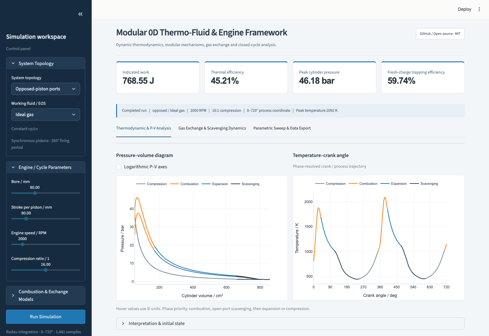

# Modular 0D Framework

[中文](README.zh-CN.md) · [English](README.md) · [日本語](README.ja.md) · [Deutsch](README.de.md)

本リポジトリは動的なエンジン・ガス交換モデル専用です。定常ブレイトン／ランキンとエクセルギー解析は独立した [Thermo Cycles](https://github.com/1844514356zjc-dev/thermo-cycles) にあります。

**機械・熱システムの研究に向けた、組み合わせ可能な零次元熱力学、可変容積機構、ガス交換のシミュレーション基盤。**

Python 3.10+ · NumPy / SciPy · CoolProp · Streamlit / Plotly · MIT License

## プロジェクト概要と主な機能

本フレームワークは、一様な気体の検査体積を対象とし、機構、ガス境界、熱物性、熱源、壁面伝熱モデルを独立に注入して計算します。共通の時間積分器により、従来型の4ストロークエンジン、同期対向ピストンエンジン、密閉ガスばね、解析解を持つ空気標準オットーサイクルを構成できます。英語のダッシュボードは、基礎方程式を変更せずにこれらの構成を操作します。

- **機構の抽象化**：`BaseMechanism` が要求するのは容積とその角度微分だけです。単一ピストンと対向ピストンには解析的なスライダ・クランク運動学を用い、独自機構も同じ2つのメソッドで接続できます。
- **ガス交換要素の合成**：任意個数の `PoppetValve` と `PistonMaskedPort` を混在させられます。弁面積にはカムリフトとカーテン面積・スロート面積の制限を、ポートには実際のピストン開口量を使います。
- **物性モデルの注入**：定物性の `IdealGas` または `CoolPropGas` を選択できます。CoolProp の密度、内部エネルギー、エンタルピー、比熱、状態方程式の微分は後処理だけでなく動的な第一法則に直接組み込まれます。
- **熱源モデルの注入**：正規化した周期 Wiebe 発熱、熱源なし、符号付きのオットー等容熱パルスに対応します。独自熱源は `heat_release(theta) -> J/rad` を実装します。
- **保存則の診断**：陰解法 `Radau` / `BDF`、圧力と状態方程式の整合性監視、符号付き流量、物理状態と同時積分される累積熱量・仕事・エンタルピー交換を備えます。
- **対話的な研究環境**：トポロジー別の操作、位相分解プロット、SI のホバー値、両対数 P–V 図、回転数・圧縮比スキャン、計算スナップショットと整合する CSV / JSON 出力を提供します。



### 対応プリセットと適用範囲

| プリセット | 機構 | ガス交換 | 熱モデル | 物性 |
| --- | --- | --- | --- | --- |
| 対向ピストン・ポート式 | 同期する2つのスライダ・クランクピストン | ピストンで開閉する吸排気窓 | Wiebe、360°ごとに発熱 | 理想気体または CoolProp 気体 |
| 4ストローク・弁式 | 単一ピストンのスライダ・クランク | 720°カム駆動の吸排気弁 | Wiebe、720°ごとに発熱 | 理想気体または CoolProp 気体 |
| 密閉空気標準オットー | 圧縮／等容停止／膨張／等容停止 | なし | 符号付き等容熱パルス | 基準と整合する定物性理想気体 |
| 密閉断熱ガスばね | 単一ピストンのスライダ・クランク | なし | 熱源・壁面熱損失なし | 理想気体または CoolProp 気体 |

エンジン計算は 0–720° の始動過渡であり、収束した周期定常サイクルではありません。この区間で対向ピストン例は2回、4ストローク例は1回発熱します。オットー基準の角度は等容停止区間を含む過程座標で、実現可能な連続クランク運動ではありません。初期・最終状態は構成上、数値許容差内で閉じます。

CoolProp の動的モデルは、バックエンドの温度範囲内の一様な単相気体に限定します。**筒内エネルギーと状態方程式を実在気体で計算する場合も、ノズル則は局所的に理想化した圧縮性流れの近似です。** 上流の cp/cv と R_eff=p/(rho*T) を用います。反応化学、相変化、液体油圧、連成した多検査体積ネットワークは対象外です。作動気体と Wiebe 熱源の指定は、非反応の所定熱入力であり、燃料と流体の化学反応を解くものではありません。既存のランキンモデルは、この気相のみの動的モデルとは別です。

## 数学・物理モデル

コアの入力単位は SI とラジアンです。UI の mm、mg、bar、クランク角度はモデル構成時に一度だけ変換します。熱およびエンタルピーの流入を正、機械仕事の流出を正とします。

### 機構と可変容積

ボア径 B、各ピストンのストローク S、連接棒長 l>S/2、クランク半径 r=S/2、ピストン面積 A_p=πB²/4、ピストン数 n=1 または 2 とすると [1]：

$$
x(\theta)=r(1-\cos\theta)+l-\sqrt{l^2-r^2\sin^2\theta},
\qquad V=V_c+nA_px,
$$

$$
\frac{dV}{d\theta}=nA_p\left(r\sin\theta+
\frac{r^2\sin\theta\cos\theta}{\sqrt{l^2-r^2\sin^2\theta}}\right),
\quad V_d=nA_pS,\quad V_c=\frac{V_d}{\varepsilon-1}.
$$

独自機構は V と dV/dθ を直接供給します。オットー基準はクランクの圧縮・膨張区間を再利用し、等容伝熱の停止区間を設けます。

### ガス交換面積と圧縮性流れ

ピストンで覆われる矩形ポートの面積は：

$$
A_{\mathrm{geo}}=W\,\mathrm{clip}(x-e,0,H),
\qquad A_{\mathrm{eff}}=C_dA_{\mathrm{geo}}.
$$

既定の弁カムは、周期的な開弁区間内で L=L_max sin²(πφ/Δθ)、区間外でリフトゼロとします。幾何学的面積は：

$$
A_{\mathrm{geo}}=\min(\pi D L,\pi D^2/4).
$$

上流状態 p_u、T_u、圧力比 q=p_d/p_u、gamma=cp/cv、臨界圧力比 q_c=(2/(gamma+1))^(gamma/(gamma−1)) に対して、ノズル近似 [3] は：

$$
|\dot m|=A_{\mathrm{eff}}\frac{p_u}{\sqrt{R_{\mathrm{eff}}T_u}}
\begin{cases}
\sqrt{\dfrac{2\gamma}{\gamma-1}
\left(q^{2/\gamma}-q^{(\gamma+1)/\gamma}\right)}, & q>q_c,\\[5pt]
\sqrt{\gamma}\left(\dfrac{2}{\gamma+1}\right)^{
\frac{\gamma+1}{2(\gamma-1)}}, & q\le q_c.
\end{cases}
$$

コアでは排気の逆流を含め、すべての流路で流入を正とします。表示層では排気流路の符号を反転し、流出を正として示します。流量係数 Cd は一度だけ適用し、リザーバとシリンダには同じ作動流体を用います。

### Wiebe 発熱と壁面モデル

周期的な燃焼区間内の燃焼座標 z=(θ−θ_s)/Δθ_b に対して [1]：

$$
\frac{dQ_{\mathrm{comb}}}{d\theta}
=Q_{\mathrm{event}}\frac{a(m_w+1)}{\Delta\theta_b}
\frac{z^{m_w}\exp[-az^{m_w+1}]}{1-\exp(-a)}.
$$

正規化により、積分値は指定した放出エネルギーに一致します。UI では燃料の低位発熱量 42.5 MJ/kg、燃焼効率 0.98 を使い、噴射燃料質量は無視します。任意選択の簡略 Woschni 壁面モデル [2] は：

$$
h=3.26B^{-0.2}p_{\mathrm{kPa}}^{0.8}T^{-0.55}w^{0.8},\quad
w=2.28\frac{2S\,\mathrm{RPM}}{60},\quad
\dot Q_{\mathrm{wall}}=h\left(2A_p+4V/B\right)(T-T_w).
$$

圧力を kPa に変換するのは、この経験相関式の内部だけです。燃焼による流速増加は省略しており、実験による校正は今後の課題です。

### 統一された第一法則の常微分方程式

rho=m/V、内部エネルギーの状態関係 u=u(T,rho) に対して：

$$
\dot V=\omega V_\theta,\quad
\omega=2\pi\,\mathrm{RPM}/60,\quad
\dot m=\sum_j\dot m_j,\quad
\dot\rho=\frac{\dot m}{V}-\frac{\rho\dot V}{V},
$$

$$
\dot H=\sum_j\dot m_jh_{u,j},\qquad
\dot Q=\omega\frac{dQ_{\mathrm{comb}}}{d\theta}-\dot Q_{\mathrm{wall}}.
$$

検査体積の第一法則と状態方程式の微分から：

$$
\dot T=\frac{\dot Q-p\dot V+\dot H-u\dot m
-m\left(\frac{\partial u}{\partial\rho}\right)_T\dot\rho}{mc_v},
\qquad
\dot p=\left(\frac{\partial p}{\partial T}\right)_\rho\dot T
+\left(\frac{\partial p}{\partial\rho}\right)_T\dot\rho.
$$

CoolProp は熱物性と均一相の微分を供給します [5]。

$$
\left(\frac{\partial u}{\partial\rho}\right)_T
=\frac{p-T(\partial p/\partial T)_\rho}{\rho^2}.
$$

`IdealGas` では u=cv*T、u_rho=0、p=rho*R*T となり、理想気体ソルバに帰着します。公開する物理状態は [p,T,m] です。追加積分変数で Q、W、H を累積し、ΔU=Q−W+H を監査します。初期圧力は選択した状態方程式に整合する必要があり、不正な状態を隠すための物理変数のクリッピングは行いません。

### 密閉サイクルと新気の指標

空気標準オットー基準では Q_out=Q_in/ε^(gamma−1) を用い、独立に検証できる解析効率を得ます。

$$
\eta_{\mathrm{Otto}}=1-\varepsilon^{1-\gamma}.
$$

無加熱の密閉ガスばねは、理想的な無損失の完全周期で質量とエントロピーを保存し、正味仕事はゼロです。熱効率は未定義です。

開放系の指標は [4] に従います。

$$
m_{\mathrm{del}}=\int\max(\dot m_{\mathrm{in}},0)\,d\theta/\omega,\quad
\mathrm{DR}=\frac{m_{\mathrm{del}}}{\rho_{\mathrm{ref}}V_d},\quad
\eta_{\mathrm{tr}}=\frac{m_{\mathrm{trap}}}{m_{\mathrm{del}}},\quad
\eta_{\mathrm{sc}}=\frac{m_{\mathrm{trap}}}{m_{\mathrm{trap}}+m_{\mathrm{res}}}.
$$

UI は完全混合の受動トレーサで保持された新気を推定します。初期充填気体と排気逆流は残留気体とみなします。対向ピストン指標は第2回転のガス交換区間、4ストローク指標は排気弁開放から最終弁閉鎖までを対象に新気純度を示します。密閉系では指標を N/A、JSON では null とし、架空のゼロ値を出しません。化学種の反応、成層、置換掃気は解きません。

## システム構成

```text
src/
├── core/
│   ├── mechanics.py         # BaseMechanism, crank/opposed/Otto volume laws
│   ├── valves_ports.py      # Reservoir, boundary ABC, poppet/port, nozzle law
│   ├── working_fluids.py    # Property ABC, IdealGas, CoolPropGas, EOS snapshots
│   ├── heat_models.py       # Heat-source protocol, Wiebe/Otto/no-heat, Woschni
│   ├── engine_solver.py     # EngineConfig, shared EngineSimulator, legacy API
│   └── scavenging_model.py  # Standalone geometry and species metrics
└── ui/
    ├── app.py               # English topology-dependent Streamlit controls
    └── engine_dashboard.py  # Composition factory, tracer, plots, reports
```

コアは Streamlit や Plotly をインポートしません。`EngineSimulator` は `EngineConfig` または SI の入れ子辞書を受け取り、部品を直接生成することもできます。`OpposedPistonEngineCycle` と従来の `Port` API は共通ソルバへのアダプタとして維持しています。

最小限の密閉気体構成：

```python
from core.engine_solver import EngineSimulator

simulator = EngineSimulator({
    "mechanism": {
        "type": "crank", "bore": 0.08, "stroke": 0.08,
        "con_rod": 0.14, "compression_ratio": 10.0,
    },
    "boundaries": [],
    "fluid": {"type": "coolprop", "name": "Nitrogen"},
    "combustion": {"type": "none"},
    "rpm": 2000.0,
})
result = simulator.solve_cycle()
print(result.energy_relative_error)
```

型付きの弁、辞書によるポート設定、厳密なオットー比較は [examples/solve_modular.py](examples/solve_modular.py)、拡張インターフェースは[構成ガイド](docs/modular-framework.md)を参照してください。

## クイックスタート

### Docker

`pyproject.toml`、`Dockerfile`、`.github/` を含むディレクトリを独立した GitHub リポジトリのルートにします。Docker Desktop または Compose 付きの Docker Engine をインストールし、デーモンを起動します。

```bash
docker-compose up
```

現在の Compose プラグインでは、次のコマンドも使えます。

```bash
docker compose up --build
```

[http://localhost:8502](http://localhost:8502) を開き、**System topology** を選択してモデルを設定し、**Run Simulation** を押します。トポロジーを切り替えると操作項目が更新され、新しい計算が成功するまで別トポロジーの古い結果は表示しません。コンテナは Python 3.10 slim、非 root ユーザ、ヘルスチェック、ローカルループバック限定のポート公開を使用します。

```bash
docker compose up --build -d
docker compose logs -f
docker compose down
```

### ローカル Python

```bash
python3.10 -m venv .venv
source .venv/bin/activate
python -m pip install --upgrade pip
python -m pip install -c requirements/validation-constraints.txt -e '.[ui,dev]'
python -m streamlit run src/ui/app.py
```

PowerShell での有効化は `.venv\Scripts\Activate.ps1` です。ハッシュ付き実行時依存は `python -m pip install --require-hashes --only-binary=:all: -r requirements.txt` で導入できます。インストールとロック管理は [CONTRIBUTING.md](CONTRIBUTING.md) を参照してください。モジュール化のための新たな実行時依存は追加していません。

### パラメータ解析とエクスポート

回転数または圧縮比の解析は、最後に成功した設定から独立に 2–12 ケースを計算します。失敗点は空欄とし、明示的な診断を残します。基準設定や解析入力が変わると以前の比較は無効になります。無損失の密閉基準では回転数は過程時間だけを変えるため、効率曲線は水平になるはずです。

CSV 列に単位を含めます。JSON はトポロジー、物性モデル、初期状態、仮定、累積エネルギー収支、組成評価区間、対応するスキャンのメタデータを含みます。ダウンロードで数値計算を再実行することはありません。

[Thermo Cycles — Brayton / Rankine](https://github.com/1844514356zjc-dev/thermo-cycles)

### 検証と CI

```bash
python -m flake8 src tests examples --count --show-source --statistics
python -m pytest -ra --strict-config --strict-markers
PYTHONPATH=src python examples/solve_modular.py
```

GitHub Actions は push / PR 時に Python 3.10、3.12、3.14 で検査し、その後コンテナのヘルス・計算スモークテストを実行します。検証項目には幾何微分、弁周期性、ノズルのチョークと逆流、混合境界、密閉気体の不変量、CoolProp 微分とエントロピー整合性、オットー解析効率、旧 API 互換性、トポロジー別 UI 動作を含みます。

補助のブレイトン／ランキン参照比較は、エンジンモデルの実験検証ではありません。実測エンジンによる校正は今後の課題です。

## 今後の課題と用途

- 多領域掃気、化学種保存、組成依存の反応気体物性と、実験で校正した伝熱・流量係数。
- 厳密な実在気体ノズル膨張、クランク位相差、代替運動則。
- 周期定常状態への反復と感度・不確かさ解析。
- 多検査体積の連成ネットワークと相変化を含む閉鎖関係。
- 有効範囲を明示した多目的遺伝的最適化とマルチフィジックス代理モデル。

熱力学教育、エンジン・ガス交換の予備研究、オープンソース手法開発、工学ポートフォリオに利用できます。排出ガス、機械的耐久性、量産エンジン性能を実証するものではありません。

## 参考文献とライセンス

1. J. B. Heywood, *Internal Combustion Engine Fundamentals*, McGraw-Hill, 1988.
2. G. Woschni, SAE 670931, 1967. [DOI](https://doi.org/10.4271/670931).
3. NASA Glenn, [Mass Flow Choking](https://www.grc.nasa.gov/www/k-12/airplane/mflchk.html).
4. MIT 2.61, [Gas Exchange Processes](https://web.mit.edu/2.61/www/Lecture%20notes/Lec.%2008%20Gas%20exchange%20processes.pdf).
5. CoolProp, [Low-Level API and thermodynamic derivatives](https://coolprop.org/coolprop/LowLevelAPI.html).

[Thermo Cycles — Brayton / Rankine](https://github.com/1844514356zjc-dev/thermo-cycles)

[MIT License](LICENSE) · [Project separation](docs/project-separation.md)
