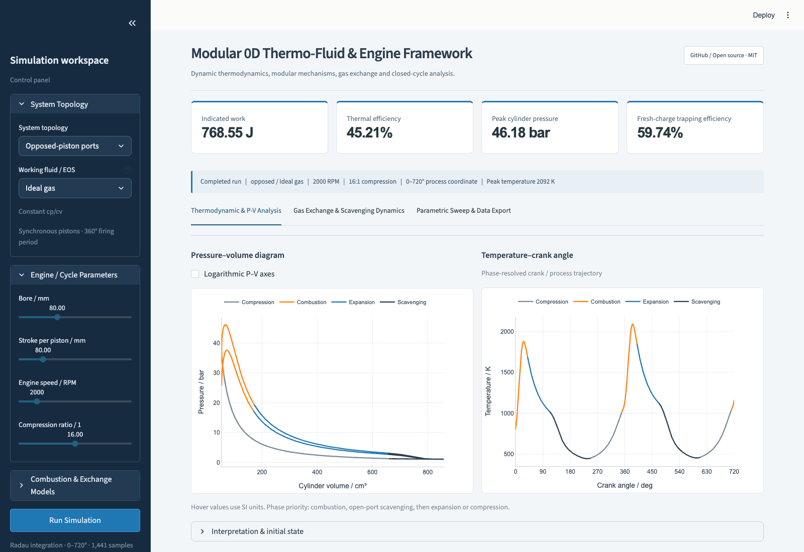

# Modular 0D Framework

**Composable thermodynamics, moving-volume mechanisms, and gas-exchange models
for mechanical and thermal-system research.**

Python 3.10+ · NumPy / SciPy · CoolProp · Streamlit / Plotly · MIT License

## Project Overview & Key Features

The framework solves a homogeneous gas control volume using independently
injected mechanisms, gas boundaries, thermophysical properties, heat sources,
and wall-loss models. A shared time integrator supports traditional four-stroke
engines, synchronous opposed-piston engines, closed gas springs, and an exact
air-standard Otto benchmark. The English dashboard exposes these compositions
without changing the core equations.

- **Mechanism abstraction:** `BaseMechanism` requires only volume and its angle
  derivative. Single-piston and opposed-piston slider–crank laws share analytic
  kinematics; custom motion laws can implement the same two methods.
- **Exchange composition:** attach any number of `PoppetValve` and
  `PistonMaskedPort` components, including mixed combinations. Valves use
  cam lift and curtain/throat limits; ports use actual piston uncovering.
- **Property injection:** choose constant-property `IdealGas` or `CoolPropGas`.
  CoolProp supplies density, internal energy, enthalpy, heat capacities, and EOS
  derivatives inside the dynamic first-law balance, not only in post-processing.
- **Heat-source injection:** normalized periodic Wiebe combustion, no heat input,
  or signed isochoric Otto heat pulses. Custom heat-source objects implement
  `heat_release(theta) -> J/rad`.
- **Conservation diagnostics:** implicit `Radau`/`BDF` integration, pressure/EOS
  consistency monitoring, signed port flows, and cumulative heat, work and
  enthalpy exchange integrated alongside the physical state.
- **Interactive research workspace:** topology-specific controls, phase-resolved
  plots, SI hover values, log P–V axes, RPM/compression-ratio studies, and
  snapshot-consistent CSV/JSON exports.
- **Companion real-fluid cycles:** the preserved CoolProp Brayton/Rankine
  laboratory remains available through `src/ui/real_fluid_app.py`.



### Supported presets and scope

| Preset | Mechanism | Exchange | Heat model | Properties |
| --- | --- | --- | --- | --- |
| Opposed-piston ports | Two synchronous slider–crank pistons | Masked intake/exhaust windows | Wiebe, 360° firing | Ideal gas or CoolProp gas |
| Four-stroke poppet valves | Single-piston slider–crank | 720° cam-driven intake/exhaust valves | Wiebe, 720° firing | Ideal gas or CoolProp gas |
| Closed air-standard Otto | Compression/isochoric dwell/expansion/isochoric dwell | None | Signed isochoric heat pulses | Matching constant-property ideal gas |
| Closed adiabatic gas spring | Single-piston slider–crank | None | None, no wall loss | Ideal gas or CoolProp gas |

Engine runs are start-up transients over 0–720°, not converged periodic steady
cycles. The opposed-piston case fires twice in this interval; the four-stroke
case fires once. Otto's angle is a process coordinate with constant-volume
dwells, not a realizable continuous crank motion. Its initial/final states
close by construction to numerical tolerance.

CoolProp support is restricted to homogeneous single-phase gases within the
backend's temperature range. **The nozzle law remains a locally idealized
compressible-flow approximation**, using upstream cp/cv and
R_eff=p/(rho*T), even when cylinder energy and EOS are real-gas calculations.
No reacting chemistry, phase change, liquid hydraulics, or coupled multi-volume
network is claimed. A named working gas and a Wiebe heat source represent a
prescribed nonreacting heat input, not a chemically resolved fuel/fluid pair.
The existing Rankine module is separate from this gas-only dynamic closure.

## Mathematical & Physical Modeling

Inputs use SI and radians. UI controls convert mm, mg, bar and crank degrees
once at the composition boundary. Positive heat and enthalpy flow enter the
control volume; positive mechanical work leaves it.

### Mechanisms and changing volume

For bore B, per-piston stroke S, rod length l>S/2, crank radius r=S/2,
area A_p=πB²/4, and piston count n=1 or 2 [1]:

$$
x(\theta)=r(1-\cos\theta)+l-\sqrt{l^2-r^2\sin^2\theta},
\qquad V=V_c+nA_px,
$$

$$
\frac{dV}{d\theta}=nA_p\left(r\sin\theta+
\frac{r^2\sin\theta\cos\theta}{\sqrt{l^2-r^2\sin^2\theta}}\right),
\quad V_d=nA_pS,\quad V_c=\frac{V_d}{\varepsilon-1}.
$$

Custom mechanisms supply V and dV/dθ directly. The Otto benchmark reuses crank
compression/expansion segments with constant-volume heat-transfer dwells.

### Exchange areas and compressible flow

A rectangular piston-masked port has

$$
A_{\mathrm{geo}}=W\,\mathrm{clip}(x-e,0,H),
\qquad A_{\mathrm{eff}}=C_dA_{\mathrm{geo}}.
$$

The default poppet cam prescribes L=L_max sin²(πφ/Δθ) within its periodic
opening interval, with zero lift outside. Its geometric area is

$$
A_{\mathrm{geo}}=\min(\pi D L,\pi D^2/4).
$$

For upstream p_u,T_u, q=p_d/p_u, gamma=cp/cv, and
q_c=(2/(gamma+1))^(gamma/(gamma−1)), the nozzle approximation [3] is

$$
|\dot m|=A_{\mathrm{eff}}\frac{p_u}{\sqrt{R_{\mathrm{eff}}T_u}}
\begin{cases}
\sqrt{\dfrac{2\gamma}{\gamma-1}
\left(q^{2/\gamma}-q^{(\gamma+1)/\gamma}\right)}, & q>q_c,\\[5pt]
\sqrt{\gamma}\left(\dfrac{2}{\gamma+1}\right)^{
\frac{\gamma+1}{2(\gamma-1)}}, & q\le q_c.
\end{cases}
$$

All core channel flows are positive inward, including exhaust backflow.
Presentation negates the exhaust channel to show positive outward flow. Cd is
applied exactly once; reservoir and cylinder states use the same working fluid.

### Wiebe and wall models

For burn coordinate z=(θ−θ_s)/Δθ_b within its periodic support [1]:

$$
\frac{dQ_{\mathrm{comb}}}{d\theta}
=Q_{\mathrm{event}}\frac{a(m_w+1)}{\Delta\theta_b}
\frac{z^{m_w}\exp[-az^{m_w+1}]}{1-\exp(-a)}.
$$

The normalized law integrates to the prescribed released energy. The UI uses
fuel LHV=42.5 MJ/kg and burn efficiency 0.98; fuel injection mass is neglected.
An optional simplified Woschni wall model [2] uses

$$
h=3.26B^{-0.2}p_{\mathrm{kPa}}^{0.8}T^{-0.55}w^{0.8},\quad
w=2.28\frac{2S\,\mathrm{RPM}}{60},\quad
\dot Q_{\mathrm{wall}}=h\left(2A_p+4V/B\right)(T-T_w).
$$

Pressure is converted to kPa only inside this empirical correlation. Combustion
velocity enhancement is omitted; experimental calibration is future work.

### Unified first-law ODE

For rho=m/V and a caloric EOS u=u(T,rho), let

$$
\dot V=\omega V_\theta,\quad
\omega=2\pi\,\mathrm{RPM}/60,\quad
\dot m=\sum_j\dot m_j,\quad
\dot\rho=\frac{\dot m}{V}-\frac{\rho\dot V}{V},
$$

$$
\dot H=\sum_j\dot m_jh_{u,j},\qquad
\dot Q=\omega\frac{dQ_{\mathrm{comb}}}{d\theta}-\dot Q_{\mathrm{wall}}.
$$

The control-volume first law and EOS derivatives give

$$
\dot T=\frac{\dot Q-p\dot V+\dot H-u\dot m
-m\left(\frac{\partial u}{\partial\rho}\right)_T\dot\rho}{mc_v},
\qquad
\dot p=\left(\frac{\partial p}{\partial T}\right)_\rho\dot T
+\left(\frac{\partial p}{\partial\rho}\right)_T\dot\rho.
$$

CoolProp provides thermodynamic properties and homogeneous derivatives [5];

$$
\left(\frac{\partial u}{\partial\rho}\right)_T
=\frac{p-T(\partial p/\partial T)_\rho}{\rho^2}.
$$

For `IdealGas`, u=cv*T, u_rho=0 and p=rho*R*T, recovering the earlier ideal-gas
solver. The public physical state is [p,T,m]. Additional integration variables
accumulate Q, W and H for the audit ΔU=Q−W+H. Initial pressure must match the
selected EOS; physical variables are never clipped to hide invalid states.

### Closed cycles and fresh-charge metrics

The air-standard Otto benchmark uses heat rejection
Q_out=Q_in/ε^(gamma−1), giving the independently checkable result

$$
\eta_{\mathrm{Otto}}=1-\varepsilon^{1-\gamma}.
$$

No-heat closed gas springs conserve mass and entropy and perform zero net work
over complete ideal lossless periods. Their thermal efficiency is undefined.

Open-system metrics follow [4]:

$$
m_{\mathrm{del}}=\int\max(\dot m_{\mathrm{in}},0)\,d\theta/\omega,\quad
\mathrm{DR}=\frac{m_{\mathrm{del}}}{\rho_{\mathrm{ref}}V_d},\quad
\eta_{\mathrm{tr}}=\frac{m_{\mathrm{trap}}}{m_{\mathrm{del}}},\quad
\eta_{\mathrm{sc}}=\frac{m_{\mathrm{trap}}}{m_{\mathrm{trap}}+m_{\mathrm{res}}}.
$$

The UI estimates retained fresh gas with a passive perfectly mixed tracer.
Preexisting charge and exhaust backflow are residual. Opposed-piston metrics
cover the second-revolution sweep; four-stroke metrics cover exhaust opening
through final valve closure and report fresh-charge purity. Closed systems
show these metrics as N/A and export JSON null, rather than fictitious zeros.
Species chemistry, layering and displacement scavenging are not resolved.

## System Architecture

```text
src/
├── core/
│   ├── mechanics.py         # BaseMechanism, crank/opposed/Otto volume laws
│   ├── valves_ports.py      # Reservoir, boundary ABC, poppet/port, nozzle law
│   ├── working_fluids.py    # Property ABC, IdealGas, CoolPropGas, EOS snapshots
│   ├── heat_models.py       # Heat-source protocol, Wiebe/Otto/no-heat, Woschni
│   ├── engine_solver.py     # EngineConfig, shared EngineSimulator, legacy API
│   ├── scavenging_model.py  # Standalone geometry and species metrics
│   └── cycle_solver.py      # Companion CoolProp Brayton/Rankine calculations
└── ui/
    ├── app.py               # English topology-dependent Streamlit controls
    ├── engine_dashboard.py  # Composition factory, tracer, plots, reports
    ├── real_fluid_app.py    # Preserved companion-cycle interface
    └── dashboard.py         # Companion-cycle plots and reporting
```

The core never imports Streamlit or Plotly. `EngineSimulator` accepts either
`EngineConfig` objects or nested SI dictionaries; components can also be
constructed directly. `OpposedPistonEngineCycle` and its original `Port` API
remain available as adapters to the shared solver.

A minimal closed-gas composition:

```python
from core.engine_solver import EngineSimulator

simulator = EngineSimulator({
    "mechanism": {
        "type": "crank", "bore": 0.08, "stroke": 0.08,
        "con_rod": 0.14, "compression_ratio": 10.0,
    },
    "boundaries": [],
    "fluid": {"type": "coolprop", "name": "Nitrogen"},
    "combustion": {"type": "none"},
    "rpm": 2000.0,
})
result = simulator.solve_cycle()
print(result.energy_relative_error)
```

See [examples/solve_modular.py](examples/solve_modular.py) for typed valves,
dictionary-configured ports, and an exact Otto comparison; see
[the composition guide](docs/modular-framework.md) for extension contracts.

## Quick Start via Docker

Use the directory containing `pyproject.toml`, `Dockerfile` and `.github/` as
the standalone GitHub repository root. Install Docker Desktop or Docker Engine
with Compose and start the daemon:

```bash
docker-compose up
```

The current Compose plugin supports:

```bash
docker compose up --build
```

Open [http://localhost:8501](http://localhost:8501), select **System topology**,
configure the active models, then press **Run Simulation**. Switching topology
refreshes controls and hides another topology's stale results until a new run
succeeds. The container uses Python 3.10 slim, a non-root runtime, a health check,
and a loopback-only port binding.

```bash
docker compose up --build -d
docker compose logs -f
docker compose down
```

For local Python development:

```bash
python3.10 -m venv .venv
source .venv/bin/activate
python -m pip install --upgrade pip
python -m pip install -c requirements/validation-constraints.txt -e '.[ui,dev,benchmark]'
python -m streamlit run src/ui/app.py
```

PowerShell activation: `.venv\Scripts\Activate.ps1`. The hash-locked runtime
is available via `python -m pip install --require-hashes --only-binary=:all:
-r requirements.txt`; package installation and lock maintenance are described
in [CONTRIBUTING.md](CONTRIBUTING.md). No new runtime dependency is required
for the modular refactor.

### Parameter studies and exports

RPM or compression-ratio studies solve 2–12 independent cases from the last
successful configuration. Failed points remain empty with explicit errors;
changed baseline/sweep inputs invalidate the previous comparison. RPM changes
only process duration for the lossless closed benchmarks, so their efficiency
trend should be flat.

CSV columns carry units. JSON includes topology, property model, initial state,
assumptions, cumulative energy budgets, species assessment bounds, and matching
sweep metadata. Download buttons do not rerun the numerical simulation.

The header's GitHub badge becomes a repository link when
`GITHUB_REPOSITORY_URL` is set to the published HTTPS GitHub URL. Without it,
the badge is static. The separate real-fluid app can be started with
`python -m streamlit run src/ui/real_fluid_app.py`.

### Verification and CI

```bash
python -m flake8 src tests benchmarks examples --count --show-source --statistics
python -m pytest -ra --strict-config --strict-markers
PYTHONPATH=src python examples/solve_modular.py
python benchmarks/validate_literature.py
```

GitHub Actions runs checks on push/PR across Python 3.10, 3.12 and 3.14, followed
by container health and calculation smoke tests. Verification covers geometry
derivatives, valve periodicity, nozzle choking/reversal, mixed boundary
composition, closed-gas invariants, CoolProp derivative/entropy consistency,
Otto analytic efficiency, legacy compatibility, and topology-aware UI behavior.
Companion Brayton/Rankine reference comparisons are not experimental validation
of the engine models. Calibration against measured engines remains future work.

## Future Work & Applications

- Multi-zone scavenging/species conservation and composition-dependent
  reacting-gas properties; experimentally calibrated heat and flow coefficients.
- Exact real-gas nozzle expansions, crank phasing, and alternative motion laws.
- Periodic steady-state iteration and sensitivity/uncertainty studies.
- Coupled multi-volume networks and phase-change control-volume closures.
- Multi-objective genetic optimization of timing/geometry/operation and
  multiphysics surrogate models with explicit validity domains.

Applications include thermodynamic teaching, preliminary engine and gas-exchange
studies, open-source method development, and engineering portfolios. Results do
not establish emissions, mechanical durability, or production-engine performance.

## References & License

1. J. B. Heywood, *Internal Combustion Engine Fundamentals*, McGraw-Hill, 1988.
2. G. Woschni, SAE 670931, 1967. [DOI](https://doi.org/10.4271/670931).
3. NASA Glenn, [Mass Flow Choking](https://www.grc.nasa.gov/www/k-12/airplane/mflchk.html).
4. MIT 2.61, [Gas Exchange Processes](https://web.mit.edu/2.61/www/Lecture%20notes/Lec.%2008%20Gas%20exchange%20processes.pdf).
5. CoolProp, [Low-Level API and thermodynamic derivatives](https://coolprop.org/coolprop/LowLevelAPI.html).

[MIT License](LICENSE). Record the source commit, dependency versions, complete
configuration and model assumptions when using results in research. There is
no assigned software DOI or institutional endorsement. Historical companion
laboratory documentation is preserved in [docs/real-fluid-laboratory.md](docs/real-fluid-laboratory.md).
