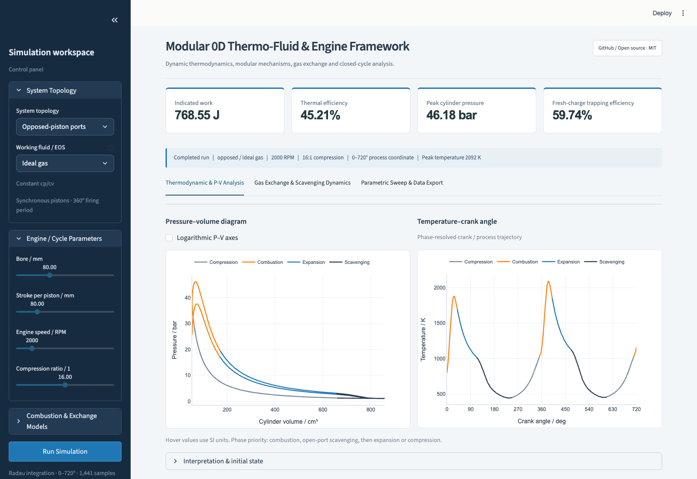

# Modular 0D Framework

[中文](README.zh-CN.md) · [English](README.md) · [日本語](README.ja.md) · [Deutsch](README.de.md)

> [!NOTE]
> **仓库定位及与 `thermo-cycles` 的边界：** 本仓库专注于可组合零维发动机与瞬态循环仿真（动态变容积机构、气体交换及控制体积分）。稳态真实流体布雷顿/朗肯循环与㶲分析位于独立兄弟仓库 [Thermo Cycles](https://github.com/1844514356zjc-dev/thermo-cycles)（详见 [项目分离说明](docs/project-separation.md)）。

**面向机械与热系统科研的可组合零维热力学、变容积机构与气体交换仿真框架。**

Python 3.10+ · NumPy / SciPy · CoolProp · Streamlit / Plotly · MIT 许可证

## 项目简介与核心特性

本框架求解均匀气体控制体。机构、气体边界、热物性、热源与壁面传热模型独立注入，使用统一的时间积分器组合出传统四冲程发动机、同步对置活塞发动机、封闭气体弹簧和具有解析基准的空气标准奥托循环。英文仪表盘直接展示这些组合，不改变核心控制方程。

- **机构抽象**：`BaseMechanism` 只要求提供容积及其对转角的导数。单活塞与对置活塞采用解析曲柄连杆运动学，自定义机构实现相同两个接口即可接入。
- **交换部件组合**：支持任意数量的 `PoppetValve` 与 `PistonMaskedPort`，也支持混合组合。气门依据凸轮升程与帘口/喉部限制计算面积；气口依据活塞实际露出量计算面积。
- **物性注入**：可选择常物性 `IdealGas` 或 `CoolPropGas`。CoolProp 的密度、内能、焓、热容及状态方程导数直接参与动态能量方程，而非只用于后处理。
- **热源注入**：支持归一化周期 Wiebe 放热、无热源及带符号的奥托等容热脉冲。自定义热源实现 `heat_release(theta) -> J/rad`。
- **守恒诊断**：使用隐式 `Radau` / `BDF` 积分，监测压力与状态方程的一致性；带符号的通道流量及累计热量、功、焓交换与物理状态同步积分。
- **交互式科研工作台**：按拓扑展示控件、相位分辨曲线、SI 悬停数据、双对数 P–V 图、转速/压缩比扫描，以及与计算快照一致的 CSV / JSON 导出。



### 支持的预设与适用边界

| 预设 | 机构 | 气体交换 | 热模型 | 物性 |
| --- | --- | --- | --- | --- |
| 对置活塞气口 | 两个同步曲柄连杆活塞 | 活塞遮蔽式进/排气窗 | Wiebe，每 360° 放热 | 理想气体或 CoolProp 气体 |
| 四冲程气门 | 单活塞曲柄连杆 | 720° 周期凸轮进/排气门 | Wiebe，每 720° 放热 | 理想气体或 CoolProp 气体 |
| 封闭空气标准奥托 | 压缩/等容停留/膨胀/等容停留 | 无 | 带符号的等容热脉冲 | 与基准匹配的常物性理想气体 |
| 封闭绝热气体弹簧 | 单活塞曲柄连杆 | 无 | 无热源、无壁面热损失 | 理想气体或 CoolProp 气体 |

发动机算例计算 0–720° 的启动瞬态，尚未迭代至周期稳态。该区间内，对置活塞算例放热两次，四冲程算例放热一次。奥托基准中的角度是包含等容停留段的过程坐标，不代表实际连续曲轴运动；初末状态在数值容差内按构造闭合。

CoolProp 动态物性仅用于后端温度范围内的均匀单相气体。**即便缸内能量和状态方程采用真实气体模型，喷嘴流动定律仍是局部理想化的可压缩流近似**，使用上游 cp/cv 与 R_eff=p/(rho*T)。本框架不包含反应化学、相变、液压或耦合多控制体网络。工质名称与 Wiebe 热源的组合表示预设的非反应放热，不表示已解析燃料与工质的化学关系。已有朗肯模块独立于这一仅限气相的动态闭合模型。

## 数学与物理模型

核心输入采用 SI 与弧度。UI 在模型组合边界将 mm、mg、bar 和曲轴角度转换一次。热量与焓流流入控制体为正，机械功流出为正。

### 机构与变容积

设缸径 B、每活塞行程 S、连杆长 l>S/2、曲柄半径 r=S/2、活塞面积 A_p=πB²/4，活塞数 n=1 或 2 [1]：

$$
x(\theta)=r(1-\cos\theta)+l-\sqrt{l^2-r^2\sin^2\theta},
\qquad V=V_c+nA_px,
$$

$$
\frac{dV}{d\theta}=nA_p\left(r\sin\theta+
\frac{r^2\sin\theta\cos\theta}{\sqrt{l^2-r^2\sin^2\theta}}\right),
\quad V_d=nA_pS,\quad V_c=\frac{V_d}{\varepsilon-1}.
$$

自定义机构直接提供 V 与 dV/dθ。奥托基准复用曲柄压缩/膨胀段，并插入等容传热停留段。

### 交换面积与可压缩流动

矩形活塞遮蔽式气口的面积为：

$$
A_{\mathrm{geo}}=W\,\mathrm{clip}(x-e,0,H),
\qquad A_{\mathrm{eff}}=C_dA_{\mathrm{geo}}.
$$

默认气门凸轮在周期开启区间内采用 L=L_max sin²(πφ/Δθ)，区间外升程为零。其几何面积为：

$$
A_{\mathrm{geo}}=\min(\pi D L,\pi D^2/4).
$$

设上游状态 p_u、T_u，压力比 q=p_d/p_u，gamma=cp/cv，临界压力比 q_c=(2/(gamma+1))^(gamma/(gamma−1))，喷嘴近似 [3] 为：

$$
|\dot m|=A_{\mathrm{eff}}\frac{p_u}{\sqrt{R_{\mathrm{eff}}T_u}}
\begin{cases}
\sqrt{\dfrac{2\gamma}{\gamma-1}
\left(q^{2/\gamma}-q^{(\gamma+1)/\gamma}\right)}, & q>q_c,\\[5pt]
\sqrt{\gamma}\left(\dfrac{2}{\gamma+1}\right)^{
\frac{\gamma+1}{2(\gamma-1)}}, & q\le q_c.
\end{cases}
$$

核心中所有通道流量均以流入为正，包括排气倒流。显示层将排气通道取反，以正值表示排出。流量系数 Cd 只施加一次；气缸与储气库使用相同工质。

### Wiebe 放热与壁面模型

周期放热区间内，燃烧坐标 z=(θ−θ_s)/Δθ_b [1]：

$$
\frac{dQ_{\mathrm{comb}}}{d\theta}
=Q_{\mathrm{event}}\frac{a(m_w+1)}{\Delta\theta_b}
\frac{z^{m_w}\exp[-az^{m_w+1}]}{1-\exp(-a)}.
$$

该归一化公式的积分等于设定放热量。UI 采用燃料低热值 42.5 MJ/kg、燃烧效率 0.98，忽略喷入燃料的质量。可选的简化 Woschni 壁面模型 [2] 为：

$$
h=3.26B^{-0.2}p_{\mathrm{kPa}}^{0.8}T^{-0.55}w^{0.8},\quad
w=2.28\frac{2S\,\mathrm{RPM}}{60},\quad
\dot Q_{\mathrm{wall}}=h\left(2A_p+4V/B\right)(T-T_w).
$$

仅在这一经验关联式内将压力转换为 kPa。当前省略燃烧引起的流速增量，实验标定属于未来工作。

### 统一第一定律常微分方程

对于 rho=m/V 和内能状态关系 u=u(T,rho)，定义：

$$
\dot V=\omega V_\theta,\quad
\omega=2\pi\,\mathrm{RPM}/60,\quad
\dot m=\sum_j\dot m_j,\quad
\dot\rho=\frac{\dot m}{V}-\frac{\rho\dot V}{V},
$$

$$
\dot H=\sum_j\dot m_jh_{u,j},\qquad
\dot Q=\omega\frac{dQ_{\mathrm{comb}}}{d\theta}-\dot Q_{\mathrm{wall}}.
$$

控制体第一定律与状态方程导数给出：

$$
\dot T=\frac{\dot Q-p\dot V+\dot H-u\dot m
-m\left(\frac{\partial u}{\partial\rho}\right)_T\dot\rho}{mc_v},
\qquad
\dot p=\left(\frac{\partial p}{\partial T}\right)_\rho\dot T
+\left(\frac{\partial p}{\partial\rho}\right)_T\dot\rho.
$$

CoolProp 提供热力学性质与均匀相导数 [5]，其中：

$$
\left(\frac{\partial u}{\partial\rho}\right)_T
=\frac{p-T(\partial p/\partial T)_\rho}{\rho^2}.
$$

对 `IdealGas`，u=cv*T、u_rho=0、p=rho*R*T，可退化为理想气体求解器。公开的物理状态为 [p,T,m]；额外积分变量累计 Q、W、H，用于检查 ΔU=Q−W+H。初始压力必须与选定状态方程一致，不通过截断物理变量掩盖非法状态。

### 封闭循环与新鲜充量指标

空气标准奥托基准采用 Q_out=Q_in/ε^(gamma−1)，得到可独立核对的解析效率：

$$
\eta_{\mathrm{Otto}}=1-\varepsilon^{1-\gamma}.
$$

无热源的封闭气体弹簧在完整理想无损周期内保持质量与熵不变，净功为零，其热效率未定义。

开式系统指标遵循 [4]：

$$
m_{\mathrm{del}}=\int\max(\dot m_{\mathrm{in}},0)\,d\theta/\omega,\quad
\mathrm{DR}=\frac{m_{\mathrm{del}}}{\rho_{\mathrm{ref}}V_d},\quad
\eta_{\mathrm{tr}}=\frac{m_{\mathrm{trap}}}{m_{\mathrm{del}}},\quad
\eta_{\mathrm{sc}}=\frac{m_{\mathrm{trap}}}{m_{\mathrm{trap}}+m_{\mathrm{res}}}.
$$

UI 采用完全混合的被动示踪剂估算保留的新鲜气体。初始气体和排气倒流均视为残余气体。对置活塞指标覆盖第二转的换气区间；四冲程指标覆盖排气门开启至最终气门关闭的区间，并报告新鲜充量纯度。封闭系统显示 N/A，JSON 导出 null，而不是虚构零值。尚未解析组分反应、分层或置换扫气。

## 系统架构

```text
src/
├── core/
│   ├── mechanics.py         # BaseMechanism, crank/opposed/Otto volume laws
│   ├── valves_ports.py      # Reservoir, boundary ABC, poppet/port, nozzle law
│   ├── working_fluids.py    # Property ABC, IdealGas, CoolPropGas, EOS snapshots
│   ├── heat_models.py       # Heat-source protocol, Wiebe/Otto/no-heat, Woschni
│   ├── engine_solver.py     # EngineConfig, shared EngineSimulator, legacy API
│   └── scavenging_model.py  # Standalone geometry and species metrics
└── ui/
    ├── app.py               # English topology-dependent Streamlit controls
    └── engine_dashboard.py  # Composition factory, tracer, plots, reports
```

核心不导入 Streamlit 或 Plotly。`EngineSimulator` 接受 `EngineConfig` 或嵌套 SI 字典，也可直接构造各部件。`OpposedPistonEngineCycle` 及原始 `Port` API 通过适配层保留。

最小封闭气体模型示例：

```python
from core.engine_solver import EngineSimulator

simulator = EngineSimulator({
    "mechanism": {
        "type": "crank", "bore": 0.08, "stroke": 0.08,
        "con_rod": 0.14, "compression_ratio": 10.0,
    },
    "boundaries": [],
    "fluid": {"type": "coolprop", "name": "Nitrogen"},
    "combustion": {"type": "none"},
    "rpm": 2000.0,
})
result = simulator.solve_cycle()
print(result.energy_relative_error)
```

更多类型化气门、字典气口及奥托精确对照见 [examples/solve_modular.py](examples/solve_modular.py)；扩展接口见[模型组合指南](docs/modular-framework.md)。

## 快速启动

### Docker

将包含 `pyproject.toml`、`Dockerfile` 和 `.github/` 的目录作为独立 GitHub 仓库根目录。安装 Docker Desktop，或安装 Docker Engine 与 Compose，并启动守护进程：

```bash
docker-compose up
```

当前 Compose 插件也支持：

```bash
docker compose up --build
```

打开 [http://localhost:8502](http://localhost:8502)，选择 **System topology**，设置模型后点击 **Run Simulation**。切换拓扑会刷新控件，并在新计算成功前隐藏旧拓扑结果。容器采用 Python 3.10 slim、非 root 用户、健康检查和仅绑定本地回环地址的端口映射。

```bash
docker compose up --build -d
docker compose logs -f
docker compose down
```

### 本地 Python

```bash
python3.10 -m venv .venv
source .venv/bin/activate
python -m pip install --upgrade pip
python -m pip install -c requirements/validation-constraints.txt -e '.[ui,dev]'
python -m streamlit run src/ui/app.py
```

PowerShell 激活命令为 `.venv\Scripts\Activate.ps1`。带哈希的运行依赖可通过 `python -m pip install --require-hashes --only-binary=:all: -r requirements.txt` 安装；安装与锁文件维护见 [CONTRIBUTING.md](CONTRIBUTING.md)。模块化重构没有增加新的运行依赖。

### 参数研究与导出

转速或压缩比扫描基于最近一次成功配置，独立求解 2–12 组工况。失败点保留为空并附诊断；基础配置或扫描输入变化后，旧比较结果失效。对无损封闭基准，转速只改变过程持续时间，因此效率曲线应保持水平。

CSV 列名包含单位。JSON 包含拓扑、物性模型、初始状态、假设、累计能量收支、组分评估区间及匹配的扫描元数据。下载按钮不会重新执行数值仿真。

[Thermo Cycles — Brayton / Rankine](https://github.com/1844514356zjc-dev/thermo-cycles)

### 验证与持续集成

```bash
python -m flake8 src tests examples --count --show-source --statistics
python -m pytest -ra --strict-config --strict-markers
PYTHONPATH=src python examples/solve_modular.py
```

GitHub Actions 在 push / PR 时对 Python 3.10、3.12、3.14 运行检查，随后执行容器健康与计算冒烟测试。验证覆盖机构导数、气门周期、喷嘴阻塞/倒流、混合边界、封闭气体不变量、CoolProp 导数与熵一致性、奥托解析效率、旧接口兼容性及拓扑相关 UI 行为。

配套布雷顿/朗肯参考对照不构成发动机模型的实验验证。实测发动机标定仍属于未来工作。

## 未来工作与应用

- 多区扫气、组分守恒和组分相关反应气体物性；传热与流量系数的实验标定。
- 精确真实气体喷嘴膨胀、曲柄相位差与其他运动规律。
- 周期稳态迭代、灵敏度与不确定性研究。
- 多控制体耦合网络与包含相变的控制体闭合模型。
- 面向配气、几何和运行工况的多目标遗传优化，以及具有明确有效域的多物理代理模型。

适用于热力学教学、发动机与气体交换初步研究、开源方法开发及工程作品集。结果不构成排放、机械耐久性或量产发动机性能的证明。

## 参考文献与许可证

1. J. B. Heywood, *Internal Combustion Engine Fundamentals*, McGraw-Hill, 1988.
2. G. Woschni, SAE 670931, 1967. [DOI](https://doi.org/10.4271/670931).
3. NASA Glenn, [Mass Flow Choking](https://www.grc.nasa.gov/www/k-12/airplane/mflchk.html).
4. MIT 2.61, [Gas Exchange Processes](https://web.mit.edu/2.61/www/Lecture%20notes/Lec.%2008%20Gas%20exchange%20processes.pdf).
5. CoolProp, [Low-Level API and thermodynamic derivatives](https://coolprop.org/coolprop/LowLevelAPI.html).

[Thermo Cycles — Brayton / Rankine](https://github.com/1844514356zjc-dev/thermo-cycles)

[MIT License](LICENSE) · [Project separation](docs/project-separation.md)
